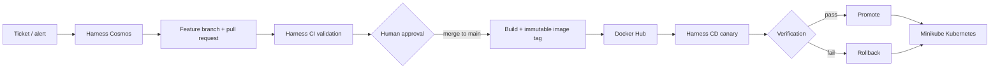

# PulseDesk

PulseDesk is a TypeScript demonstration application for an enterprise Harness
Solutions Engineer assessment. It presents synthetic operational tickets,
reproduces a deterministic revenue-cycle regression, prepares a focused fix,
and keeps human approval between code generation and delivery.

The primary scenario is `TICKET-1042`: a duplicate insurance claim submission
on retry. All identifiers and data are synthetic. This is not a clinical or
patient-safety application.

## Architecture



The application itself has four workspaces:

- `web/` - React/Vite ticket inbox and run-review UI.
- `claims-api/` - Express API, ticket workflow, deterministic gate, and static
  production web serving.
- `claims-status-api/` and `scheduling-api/` - secondary synthetic services
  used by ticket fixtures.
- `fixtures/` - synthetic ticket data only.

The root `Dockerfile` builds the API and web application into one non-root
runtime image. `k8s/` contains the Kubernetes Deployment and Service consumed
by Harness CD.

## Prerequisites

- Node.js 22 and pnpm 11.25.0
- Docker Desktop
- Minikube and kubectl
- A GitHub repository and Harness project
- A Docker Hub repository and token stored in Harness, never in Git

## Local development

```bash
pnpm install
pnpm --dir claims-api dev
pnpm --dir web dev
```

The API defaults to `http://127.0.0.1:4310`. The web development server prints
its URL and proxies `/api` requests to the API.

## Validation

Use the repository's state-aware gate instead of `pnpm -r test`:

```bash
pnpm --dir claims-api gate
pnpm --dir web test
pnpm --dir scheduling-api test
pnpm -r typecheck
pnpm --dir claims-api build
pnpm --dir web build
```

On the planted baseline, the gate exits successfully only when the named
`TICKET-1042` regression is the one expected failure. On the focused patch, it
exits successfully only when the complete claims suite is green. Other sample
tickets intentionally retain red fixtures, so recursive workspace testing is
not the baseline CI command.

## Docker

Build and smoke-test the production image locally:

```bash
docker build -t pulsedesk:local .
docker run --rm -p 4310:4310 pulsedesk:local
curl --fail http://127.0.0.1:4310/api/health
curl --fail http://127.0.0.1:4310/api/tickets
```

CI should publish both an immutable commit SHA tag and, optionally, `latest`.
Harness CD must deploy the immutable tag selected from the CI artifact, not
re-resolve `latest`.

## Minikube

The current manifests use Harness's primary-artifact expression. For local
validation, replace it in the stream without editing the committed manifest:

```bash
docker build -t pulsedesk:local .
minikube image load pulsedesk:local
kubectl create namespace pulsedesk --dry-run=client -o yaml | kubectl apply -f -
sed 's|<+primary.artifact.image>|pulsedesk:local|' k8s/deployment.yaml \
  | kubectl -n pulsedesk apply -f -
kubectl -n pulsedesk apply -f k8s/service.yaml
kubectl -n pulsedesk rollout status deployment/pulsedesk --timeout=180s
kubectl -n pulsedesk port-forward service/pulsedesk 4310:80
curl --fail http://127.0.0.1:4310/api/health
```

See [k8s/README.md](k8s/README.md) for manifest details and cleanup.

## Harness and Cosmos

- [docs/HARNESS.md](docs/HARNESS.md) describes CI triggers, Docker Hub,
  Kubernetes connector/delegate, CD canary, verification, promotion, rollback,
  and Cosmos prerequisites.
- [docs/ASSESSMENT_STATUS.md](docs/ASSESSMENT_STATUS.md) is the evidence-backed
  gap analysis and current status checklist.
- [DEMO.md](DEMO.md) is the live assessment script.

## Troubleshooting

- If `tsx` reports an IPC permission error in a restricted shell, rerun the
  command in the normal local terminal. This is a shell sandbox limitation, not
  an application failure.
- If Minikube is unreachable, verify Docker Desktop first, then run
  `minikube status` and `kubectl config current-context`. Do not recreate the
  cluster until its existing state has been inspected.
- If the delegate is unready after Docker Desktop restarts, allow its configured
  readiness window to elapse and inspect recent logs for a successful
  registration and heartbeat.
- If CI fails on the intentional regression, confirm it runs
  `pnpm --dir claims-api gate` and does not run `pnpm -r test`.
- If an image cannot be pulled, verify the exact registry namespace, tag,
  connector credentials, and any Kubernetes image pull secret.

## Cleanup

The local application namespace can be removed when the demo is finished:

```bash
kubectl delete namespace pulsedesk
docker image rm pulsedesk:local
```

Do not delete the Harness delegate namespace, connectors, registry artifacts,
or GitHub branch protections as part of routine application cleanup.
