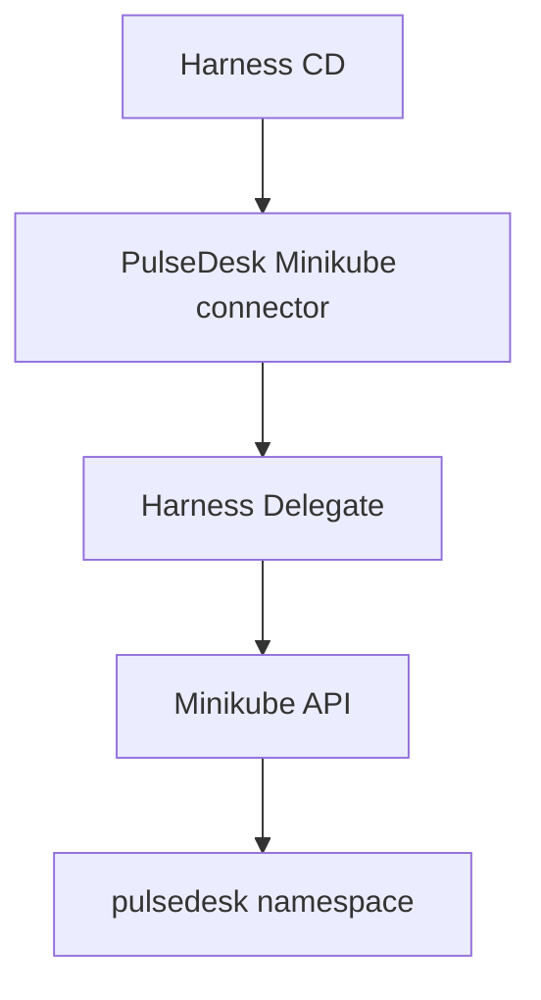

# Harness implementation guide

This document separates repository configuration from account-scoped Harness,
GitHub, and Docker Hub changes. Never paste access tokens into YAML, Git, shell
history, screenshots, or pipeline logs.

## Harness CI

The existing remote pipeline is stored at:

```text
.harness/orgs/default/projects/PulseDesk/pipelines/PulseDesk_Build.yaml
```

Its intended behavior is:

- every branch push runs validation;
- pull requests targeting `main` run validation;
- only a `main` push runs the image publication step;
- published images use the commit SHA and optional `latest` tags;
- PRs never publish or deploy.

The validation commands intentionally match `AGENTS.md`. Do not replace the
state-aware gate with `pnpm -r test`; unresolved demo fixtures are allowed to be
red. Web and scheduling Vitest results are emitted as JUnit. Harness JavaScript
Test Intelligence has not been claimed because this repository uses Vitest and
the account feature state is unverified; the pipeline explicitly disables test
splitting while retaining report ingestion.

### GitHub status checks

1. In the `PulseDesk_GitHub` connector, verify API access and webhook creation
   permissions.
2. Run the PR trigger once so Harness creates its real GitHub check context.
3. In GitHub, add a `main` branch protection/ruleset that requires a pull
   request, at least one human approval, and that exact Harness check.
4. Do not guess the status name. Confirm a failing PR cannot merge, then confirm
   the repaired PR can merge after approval.

## Docker Hub

The assessment explicitly requires Docker Hub. The repository currently retains
the prior GHCR target until the correct namespace is confirmed.

1. Create or select a Docker Hub repository such as `<namespace>/pulsedesk`.
2. Create a Docker Hub access token with only the required repository rights.
3. Store the username and token as Harness secrets.
4. Create a project connector named `PulseDesk_DockerHub` with Docker Registry
   URL `https://index.docker.io/v2/` and test the connection.
5. Change the pipeline connector and repository to the verified values.
6. Run a `main` build and verify the commit SHA tag is retrievable.
7. Configure the CD service's primary artifact to use the same connector and
   repository. Select the immutable SHA tag produced by CI.

Do not add Docker credentials to Kubernetes manifests. If the repository is
private, create an image pull secret through a controlled Harness/Kubernetes
workflow and reference only the secret name.

## Kubernetes connector and delegate

Target architecture:



Create a Harness Kubernetes Cluster connector using the delegate installed in
Minikube. Prefer delegate selectors that identify the intended delegate rather
than allowing ambiguous selection across both installed deployments. Test the
connector from Harness and record the successful test.

Create these reusable CD entities:

- Service: `PulseDesk`
  - Primary artifact: Docker Hub `<namespace>/pulsedesk`
  - Manifest store: `PulseDesk_GitHub`, branch `main`
  - Deployment manifest: `k8s/deployment.yaml`
  - Service manifest: `k8s/service.yaml`
- Environment: `Local_Minikube`
- Infrastructure: `PulseDesk_Minikube`
  - Namespace: `pulsedesk`
  - Kubernetes connector: the verified Minikube connector

The manifest image must remain `<+primary.artifact.image>` so Harness deploys
the artifact selected by the service.

## Canary, verification, promotion, and rollback

Use Harness native deployment steps rather than shelling out to kubectl:

1. Download and render the service manifests.
2. Kubernetes Canary Deploy with one canary instance.
3. Kubernetes steady-state check.
4. HTTP verification of `/api/health` from the delegate network.
5. Harness Approval with one human approver.
6. Kubernetes Rolling Deploy for full promotion.
7. Kubernetes Canary Delete for cleanup.

Configure the stage failure strategy to run canary cleanup and stage rollback
for infrastructure, timeout, and verification failures. Verify the behavior
with an execution input that changes only the verification path to a known 404.
After rollback, check rollout state and the real health endpoint.

Continuous Verification or AI Verify is optional for this local assessment. It
requires the relevant Harness entitlement plus a supported telemetry connector
and meaningful deployment data. If those are unavailable, use the native
steady-state check, HTTP health gate, approval, and rollback rather than
simulating an AI verification result.

## Reusable template bonus

After the delivery execution works, convert the HTTP health verification or the
Node validation step into a project-scoped step template pinned to a semantic
version. Reference the template from the pipeline and demonstrate one update or
reuse. Do this after core delivery so template troubleshooting cannot block the
required canary.

## Harness Cosmos

Cosmos must be verified as a separate product integration. A valid ticket-to-PR
setup needs:

- an enabled Cosmos workspace/entitlement;
- GitHub App access to `Hollywood/PulseDesk`;
- read/write branch and pull-request permissions without merge authority;
- a ticket/event source or webhook that can dispatch `TICKET-1042`;
- an isolated execution environment with repository build dependencies;
- repository instructions that preserve synthetic data and human approval;
- a PR trigger into the independent Harness CI pipeline.

The desired boundary is: Cosmos may investigate, edit, test, push a feature
branch, and open/update a PR. It must not approve, merge, publish, or deploy.
If Cosmos is unavailable, use PulseDesk's deterministic local analysis as the
ticket-to-patch narrative and demonstrate the real CI/CD path independently.

## Evidence and troubleshooting

- Delegate installed is not the same as delegate connected. Require an
  Available deployment plus recent successful registration/heartbeat evidence.
- A green local Docker build is not proof of a remote registry push. Verify the
  exact immutable tag from a clean pull or registry view.
- A rendered manifest is not proof of deployment. Require Harness execution
  logs, Kubernetes rollout state, pod readiness, service endpoints, and an HTTP
  health response.
- A canary step is not proof of rollback. Capture a forced verification failure
  and the stable application health afterward.
- Keep screenshots and relevant execution links in a separate assessment
  evidence document as required by the candidate lab.
